<p align="center">
  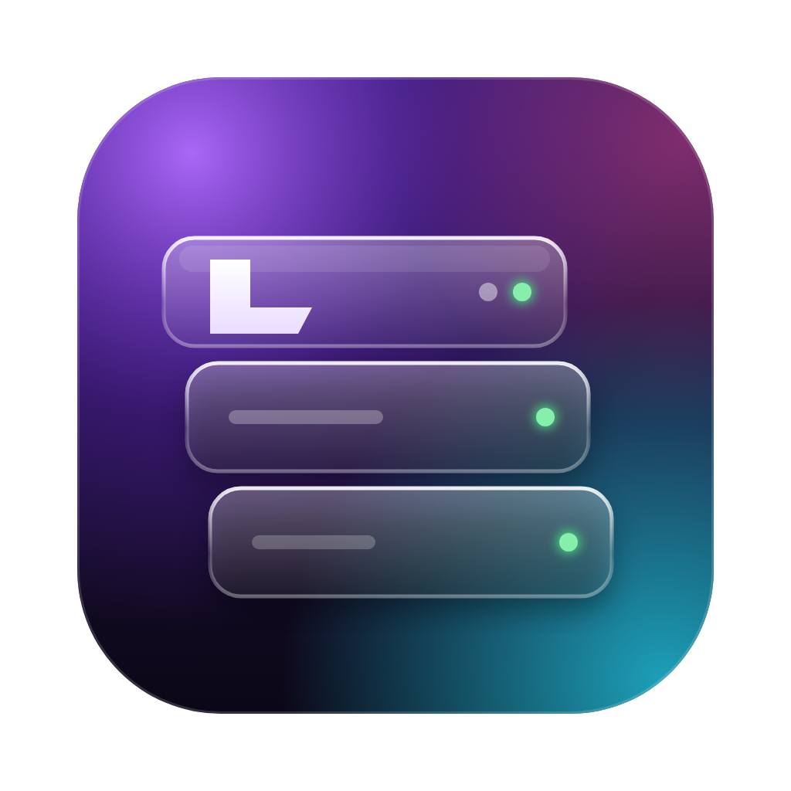
</p>

<h1 align="center">Laramac</h1>

<p align="center">
  <strong>The local development environment for macOS.</strong><br>
  PHP, JavaScript, Python, C#, Go, Rust and Swift projects in one click, with Apache, every database you need, SSH, deployment, an API client and GitHub, in one app. Free and open source.
</p>

<p align="center">
  <a href="#install">Install</a> ·
  <a href="#a-tour-of-laramac">Tour</a> ·
  <a href="#starters">Starters</a> ·
  <a href="#coming-from-laragon">Coming from Laragon</a> ·
  <a href="#troubleshooting">Troubleshooting</a> ·
  <a href="#security">Security</a>
</p>

<p align="center">
  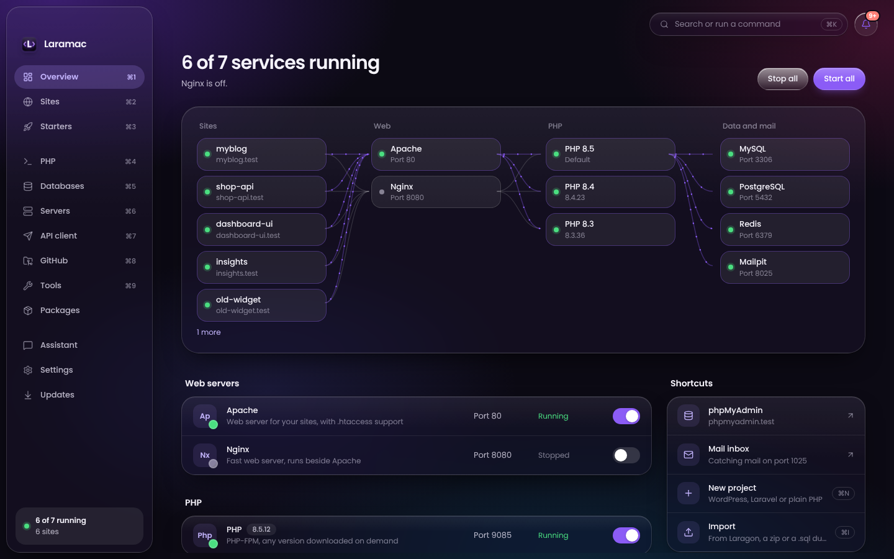
</p>

---

## What is Laramac?

Laramac turns your Mac into a complete development machine without touching the terminal. Drop a project folder into `~/Laramac/www` and it is immediately live at `https://folder.test`, with the PHP version you choose, a database, HTTPS that your browser trusts, and email captured locally.

It was built for people moving from **Laragon** on Windows who want the same "it just works" feeling on a Mac, and it goes further: it can deploy your sites to a server, push them to GitHub, test your APIs, and let Claude Code manage the whole stack for you.

**In short, Laramac gives you:**

- **Instant sites.** Every folder becomes `https://name.test`, plus `http://localhost/name` and `name.localhost`, so existing projects work unchanged.
- **Starters for every stack.** React, Next.js, Vue, Nuxt, Svelte, Angular, Astro, Laravel with React, Vue, Svelte or Livewire, Symfony, Django, FastAPI, ASP.NET Core, Go, Rust, Expo, Tauri, Electron, SwiftUI and more. Each one runs the framework's own official setup tool, so you always get the newest version, and Laramac installs the language it needs first.
- **Dev servers at real addresses.** Vite, Next.js, Django, `dotnet watch` and the rest run from the Sites page and open at `https://name.test`, live reload included.
- **Every PHP version.** PHP 8.0 to 8.5, side by side, always the newest release, chosen per site.
- **Apache and Nginx.** Apache with full `.htaccess` support as the main server, Nginx alongside.
- **Databases.** MySQL, MariaDB, PostgreSQL, Redis, Memcached, MongoDB and Meilisearch, plus phpMyAdmin and Adminer, with backups and snapshots.
- **Your servers.** SSH terminal, SFTP and FTP file browser, and one-click deployment.
- **GitHub.** Create, browse, clone, download and delete repositories, and push to main, a branch, a tag or a release.
- **An API client.** Works like Postman: import collections and environments, write tests, run whole collections, and copy any request as code.
- **AI.** Claude Code, Codex, OpenCode, vMLX, LM Studio and more, and a direct connection so Claude Code can drive Laramac.
- **Safety.** Snapshots of any site's files and database, reset without uninstalling, and updates that keep everything.

---

## Install

**Requirements:** macOS 12 or later on Apple Silicon or Intel. Designed for macOS 26 and macOS 27 Golden Gate with Liquid Glass. [Homebrew](https://brew.sh) is needed only for Apache, Nginx, MariaDB, Redis and Memcached; everything else downloads directly.

### Option 1: one line in Terminal (recommended)

```sh
curl -fsSL https://raw.githubusercontent.com/Pino10/laramac/main/install.sh | bash
```

This downloads the newest release for your Mac, checks it against the published SHA-256 checksum and its code signature, and installs it in Applications. macOS does not ask you to approve it in Privacy & Security. Run the same line again any time to reinstall or update.

### Option 2: download the DMG

1. Download `Laramac-<version>-arm64.dmg` (Apple Silicon) or `-x64.dmg` (Intel) from [Releases](https://github.com/Pino10/laramac/releases).
2. Drag Laramac to Applications and open it.
3. The first time, macOS says it cannot verify the developer. Click **Done**, open **System Settings › Privacy & Security**, scroll down and click **Open Anyway**.

### First run

1. On the **Overview**, press **Set up my stack**. Laramac installs the newest PHP, Apache, MySQL, phpMyAdmin and Mailpit, starts them, turns on `.test` addresses and trusts local HTTPS. macOS asks for your password twice.
2. Put a project in `~/Laramac/www` (or create one under **Sites › New project**).
3. Open `https://yourproject.test`.

After this, updates install from inside the app and never touch your projects, databases or settings.

---

## A tour of Laramac

### Overview


Your whole stack at a glance. The **live map** shows every site, the web server that serves it, the PHP version it runs on and the services behind it; connections pulse when both ends are running, and clicking any box takes you to it. Below it, every service has a switch, its port and its status, with the reason shown in place if one fails to start. **Start all** and **Stop all** do what they say. Shortcuts open phpMyAdmin, the mail inbox, a new project or an import.

### Sites

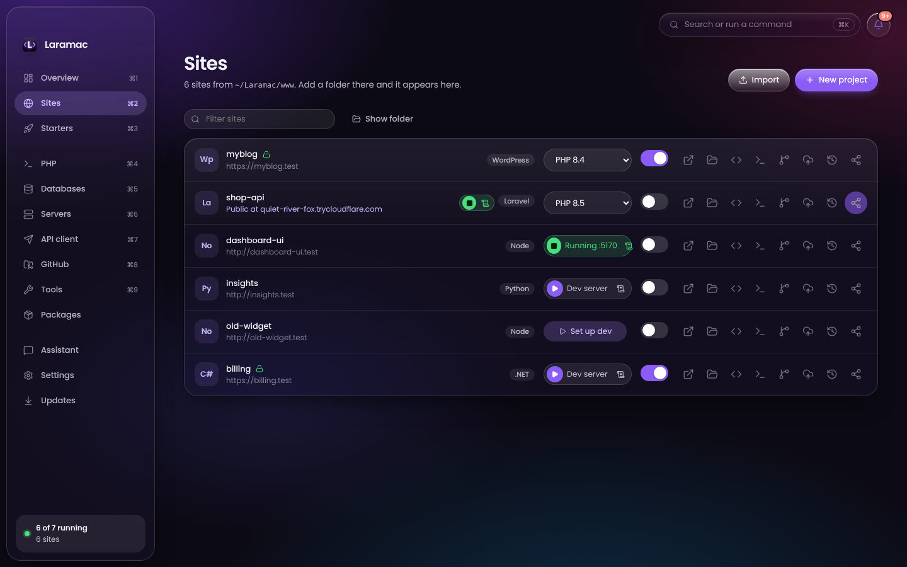

Every folder in your projects folder is a site. Laramac recognises **Laravel, WordPress, Symfony, plain PHP and static sites** and serves the right folder (for example `public/` for Laravel). For each site you can:

| Action | What it does |
| --- | --- |
| **PHP version** | Pick 8.0 to 8.5 for this site alone. |
| **HTTPS** | One switch for a trusted `https://` certificate. |
| **Open** | In the browser, in Finder, in Cursor or VS Code (as a project with its file tree), or in your AI tool. |
| **Share** | A public link through Cloudflare Tunnel (no account) or ngrok, copied to your clipboard. |
| **Snapshots** | Save the site's files and database together, restore any snapshot, or export it. |
| **Deploy** | Upload the site to your hosting over SFTP, FTPS or FTP. |
| **Push to GitHub** | Commit and push, choosing main, a branch, a tag or a release. |

**Addresses.** Each site answers at `https://name.test`, `http://localhost/name`, `http://127.0.0.1/name` and `http://name.localhost`, and you can add your own names (such as `shop.local`) in **Settings › Addresses**. Wildcard subdomains work too (`api.name.test`).

**New projects.** Blank PHP, WordPress (with its database created and `wp-config.php` filled in) or Laravel (through Composer, with `.env` pointed at MySQL and Mailpit).

**Import.** Bring in a site from Laragon, a server backup or a teammate: a `.zip`, `.tar.gz`, folder or `.sql` dump. Laramac finds the project and its database inside, asks a few questions, copies the files, loads the database and updates `wp-config.php` or `.env`.

#### Snapshots

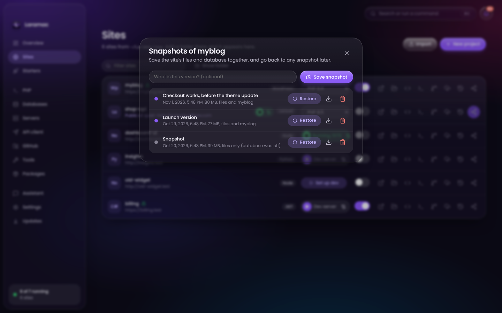

A snapshot is the site's files and its database saved together in one archive. Take one before a big change; **Restore** puts both back exactly, and first saves the current state as another snapshot so a restore can always be undone. **Export** gives you a single file that Laramac's Import understands, so you can move a working version to another Mac.

#### Deploy

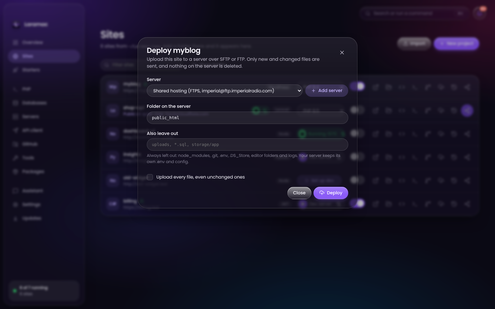

Choose a saved server and a folder such as `public_html` or `/var/www/site`. The first deploy uploads everything; after that only new and changed files are sent. Nothing on the server is ever deleted, and `.env`, `node_modules`, `.git`, `.DS_Store`, editor folders and logs stay on your Mac, so your live configuration is never overwritten. Add your own exclusions (like `uploads` or `*.sql`) per site.

#### Push to GitHub

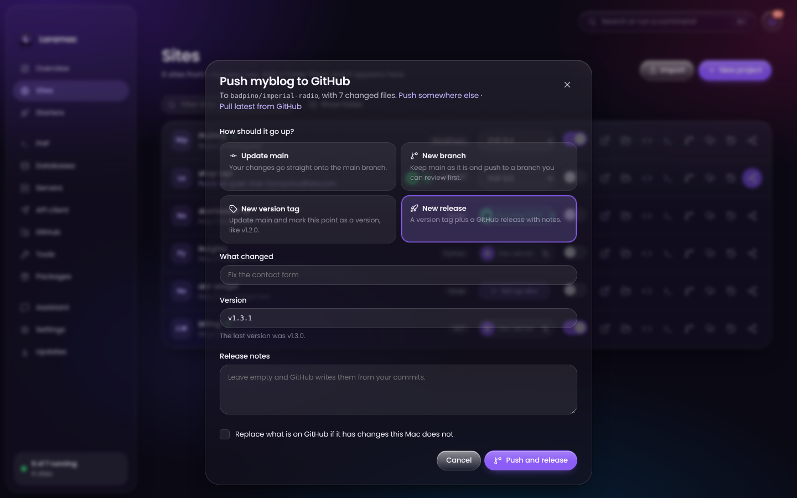

Every push asks how it should go up:

- **Update main:** your changes go straight onto main.
- **New branch:** main stays as it is; Laramac links you to open a pull request.
- **New version tag:** updates main and marks the version (it suggests the next number, so `v1.3.0` becomes `v1.3.1`).
- **New release:** a tag plus a GitHub release with notes (or notes GitHub writes from your commits).

If GitHub has commits your Mac does not, the push stops and explains; tick **Replace what is on GitHub** only when you mean to overwrite them. A site that is not on GitHub yet gets a new repository (private by default) and a `.gitignore` that keeps secrets out.

### Starters

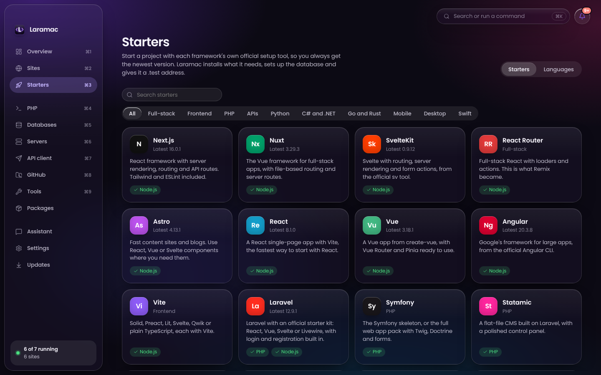

Open **Starters** in the sidebar, pick a framework, type a folder name and press **Create**. Laramac:

1. **Installs what is missing.** Node.js, Bun, Python (through uv), .NET, Go or Rust, downloaded from their official sources, checked against the published checksums, and kept in `~/.laramac/runtimes` so nothing else on your Mac changes. Copies you already have (from Homebrew, say) are used instead. The **Languages** tab shows each one with its version and the newest release, and updates them.
2. **Runs the official setup tool**, such as `create-vite`, `create-next-app`, `sv create`, `ng new`, `composer create-project`, `uv init`, `dotnet new` or `cargo new`, so the project is exactly what the framework's own docs would give you, at its newest version (shown on each card).
3. **Prepares the rest:** starts MySQL or PostgreSQL and creates the database, fills in `.env`, runs migrations, installs packages, builds assets, and makes the first Git commit if you want one.
4. **Starts the dev server** and opens it at `http://name.test`.

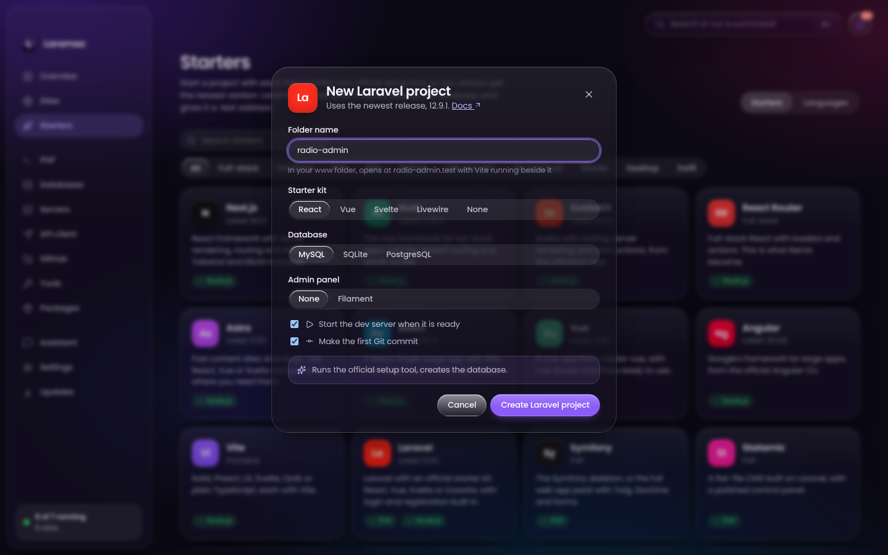

| Group | Starters |
| --- | --- |
| Full-stack | Next.js, Nuxt, SvelteKit, React Router (Remix), Astro |
| Frontend | React, Vue, Angular, and Vite with Solid, Preact, Svelte, Lit, Qwik or plain TypeScript |
| PHP | Laravel (React, Vue, Svelte or Livewire starter kit, MySQL, PostgreSQL or SQLite, optional Filament admin), Symfony, Statamic, Drupal, Craft CMS, Slim, CodeIgniter, plus WordPress and blank PHP under **New project** |
| APIs | NestJS, Hono, Elysia on Bun |
| Python | FastAPI, Django, Flask, Streamlit |
| C# and .NET | ASP.NET Core (Web API, Blazor, MVC, Razor Pages, gRPC), console apps, workers and libraries |
| Go and Rust | Go (standard library or Gin), Rust with Axum |
| Mobile and desktop | Expo (React Native), Tauri, Electron |
| Swift | SwiftUI apps for iPhone, iPad or Mac (opens in Xcode), Vapor, Swift packages |

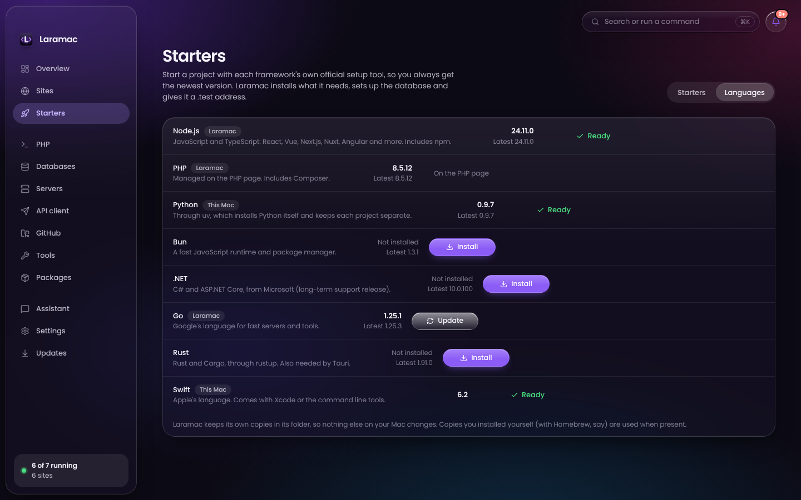

Swift needs Apple's tools: the **Languages** tab opens Apple's installer for the command line tools, and iPhone and Mac apps also need Xcode from the App Store.

#### Dev servers

Projects with their own server (Vite, Next.js, Django, `dotnet watch`, `go run` and so on) show a **dev server** control on the Sites page instead of a PHP version:

- **Play** starts it on its own port (from 5170 up) and `name.test` passes straight through to it, live reload included. **Stop** stops it and everything it started.
- **Output** shows what it prints, live, with buttons to open `name.test` or `127.0.0.1:port`.
- When it is not running, `name.test` shows a page saying so and reloads by itself once you start it.
- Any JavaScript project you drop into www that has a `dev` script gets a **Set up dev** button that does the same.
- Laravel starter kits keep being served by PHP; their dev server is Vite, running beside it for instant updates.

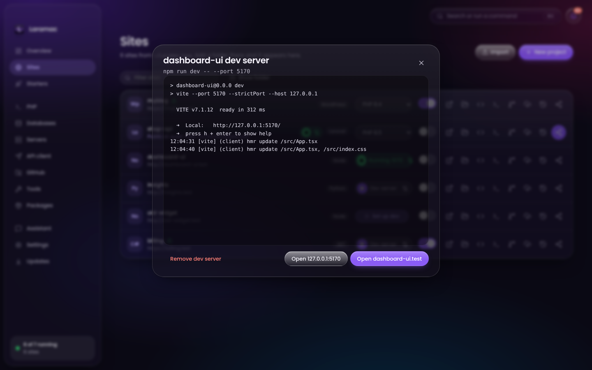

### PHP

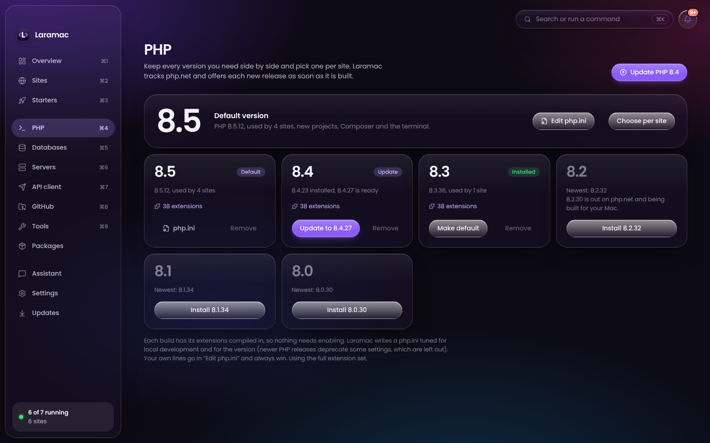

Install any version from 8.0 to 8.5 and keep several side by side. Laramac follows php.net: a daily build turns each new release into a ready-to-run build for Apple Silicon and Intel, and the app offers it as an update. Every build has the common extensions compiled in (such as mysqli, pdo_mysql, intl, gd, zip and opcache; **Extensions** lists every one). Laramac writes a `php.ini` tuned for local development and for that version, and **Edit php.ini** gives you a file of your own settings that always wins. Composer is included.

### Databases

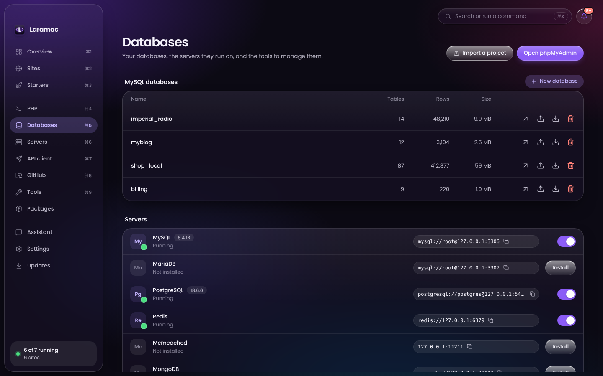

See every MySQL and MariaDB database with its tables, rows and size, and for each one:

- **Open** it straight in phpMyAdmin.
- **Import** a `.sql` or `.sql.gz` file into it.
- **Back up** to a compressed file with tables, data, routines and triggers.
- **Delete** it (you type its name to confirm).

**New database** creates an empty one. Below, every database server has its switch, version and a connection string to copy. None of them needs a password on your Mac (user `root`).

| Server | Port | Connect with |
| --- | --- | --- |
| MySQL 8.4 | 3306 | `localhost`, `127.0.0.1` or `localhost:3306` |
| MariaDB | 3307 | `127.0.0.1:3307` |
| PostgreSQL | 5432 | `postgresql://postgres@127.0.0.1:5432` |
| Redis | 6379 | `redis://127.0.0.1:6379` |
| Memcached | 11211 | `127.0.0.1:11211` |
| MongoDB | 27017 | `mongodb://127.0.0.1:27017` |
| Meilisearch | 7700 | `http://127.0.0.1:7700` |

phpMyAdmin (at `phpmyadmin.test`, signed in for you) and Adminer (`adminer.test`) install in one click.

### Servers: SSH, SFTP and FTP

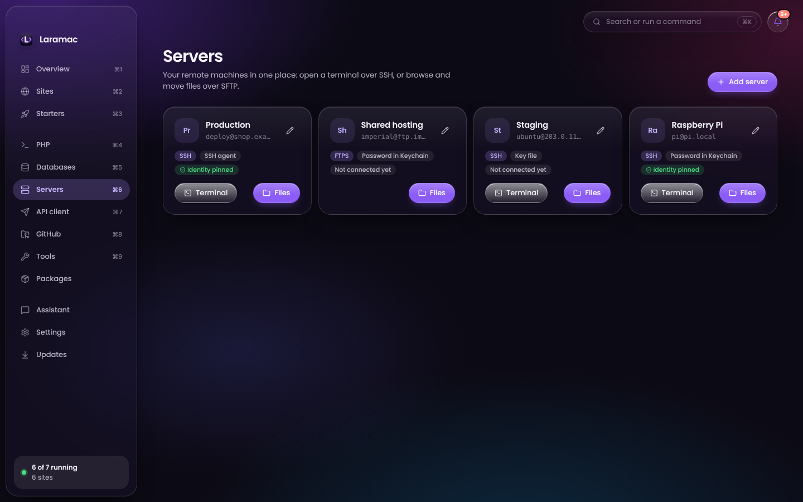

Save your VPS, staging box or shared hosting account. SSH servers can sign in with your SSH agent, a key file or a password; FTP and FTPS accounts use a password. Passwords are encrypted with the macOS Keychain.

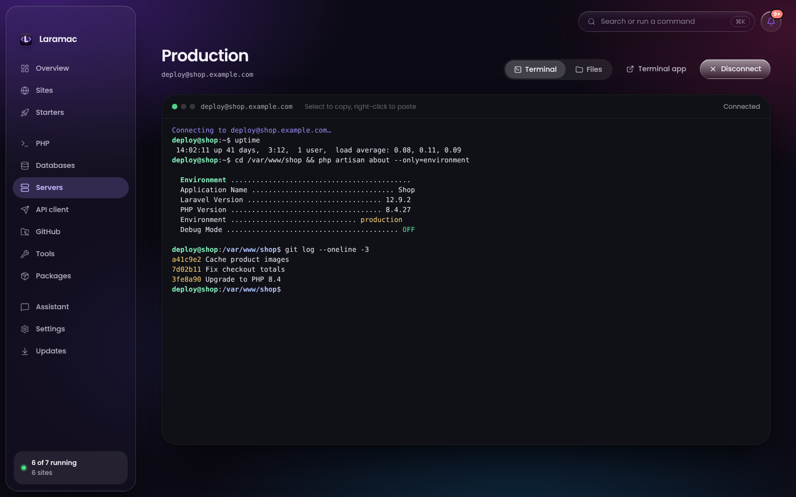

- **Terminal:** a full SSH terminal inside Laramac. Select text to copy it, right-click to paste, or use ⌘C, ⌘V, ⌘A and ⌘K (clear). **Terminal app** opens the same server in macOS Terminal.
- **Files:** a WinSCP-style browser: open folders, upload, download, create folders, rename and delete. Terminal and Files stay connected as you switch between them.
- **Server identity:** the first time you connect, Laramac shows the server's fingerprint for you to confirm, then refuses to connect if it ever changes.

### API client

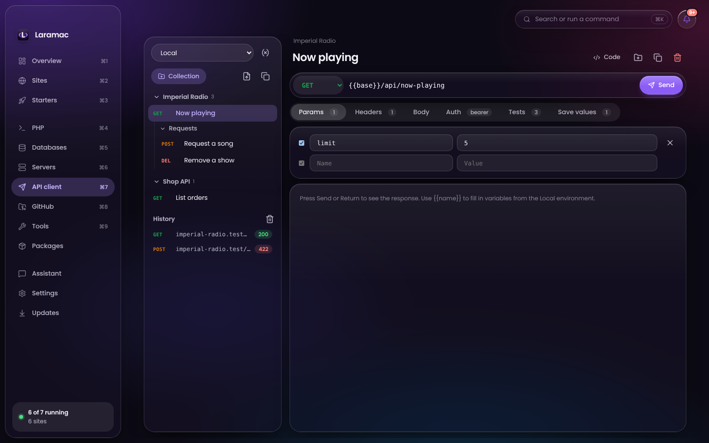

Build, save and test API requests without Postman or Insomnia:

- **Requests:** any method, query parameters, headers, JSON, text, URL-encoded or multipart bodies, and bearer or basic authentication.
- **Collections** keep requests organised; **environments** hold `{{variables}}` such as `{{base}}` and `{{token}}`, so one click switches between Local and Production.
- **Responses** show status, time, size and headers, with colour-coded JSON.
- **Tests** check every response: the status, how long it took, a header, a value in the JSON or text in the body. Results show next to the response, and each request in the sidebar gets a green or red dot.
- **Save values** from a response into the environment, such as a login token into `{{token}}`, so the next request can use it.
- **Run** a whole collection or one folder in order and see what passed, with a link to each request.
- **Folders, collection variables, rename, duplicate, move and delete**, all in the sidebar.
- **History** keeps your recent calls; **Code** turns any request into cURL, JavaScript, PHP or Python.
- **Import** a Postman collection (folders, variables and simple test scripts included), a Postman environment, an Insomnia export or an OpenAPI (JSON) file, or paste a cURL command. **Export** sends a collection back to Postman.

Requests are sent by Laramac itself, so the browser's cross-site limits do not apply and your local `.test` sites work over HTTPS.

### GitHub

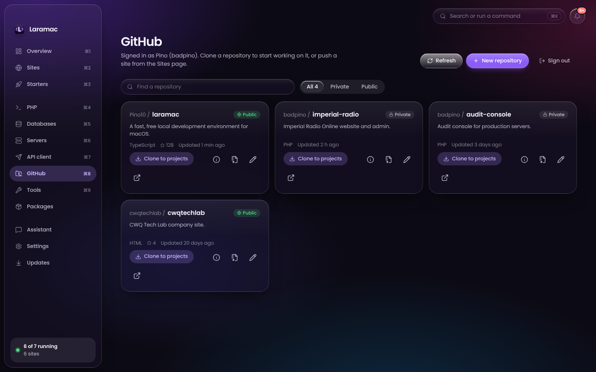

Connect once, with your GitHub CLI sign-in or a personal access token (kept encrypted in the Keychain), and see all your public and private repositories, with search and filters. **New repository** creates one (private or public, with a README if you like) and can clone it into your projects folder straight away. Click a repository's name to see its branches, releases, recent commits, pull requests and issues. **Clone to projects** puts a repository in your projects folder, ready to run; **Download ZIP** saves a copy anywhere. **Edit** changes a repository's description, website and visibility, and **Delete** removes it after you type its name. When your token is missing a permission (deleting needs `delete_repo`), Laramac says exactly which one to add. Pushing happens from each site (see [Push to GitHub](#push-to-github)).

### Tools and AI

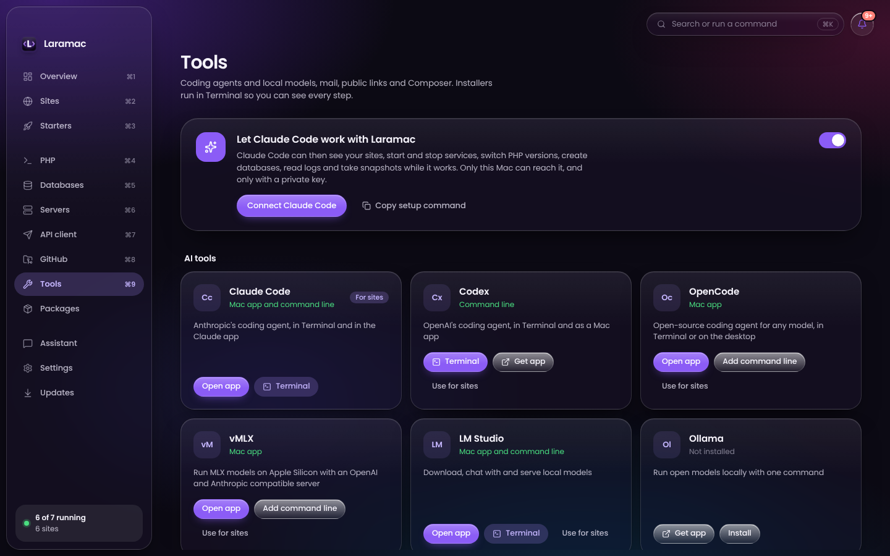

- **Let Claude Code work with Laramac.** One click connects Claude Code to Laramac. Claude can then list your sites, start and stop services, switch a site's PHP version, create databases, run read-only queries, read logs and take snapshots while it works on your code. It works only on your Mac and needs a private key.
- **AI tools.** Claude Code, Codex, OpenCode, vMLX, LM Studio, Ollama, OpenClaw and Gemini CLI. Laramac finds both the Mac apps and the command-line versions, installs what is missing with each project's official installer, and opens your chosen tool from any site.
- **Mail.** Mailpit catches every email your apps send (SMTP `127.0.0.1:1025`, inbox at `http://127.0.0.1:8025`). PHP's `mail()` is wired to it.
- **Public links.** Choose Cloudflare Tunnel (no account) or ngrok.
- **Composer** and your preferred **editor** (Cursor or VS Code).
- **Assistant.** A built-in helper that runs on your own local model (Ollama, LM Studio or any OpenAI-compatible server).

### Packages

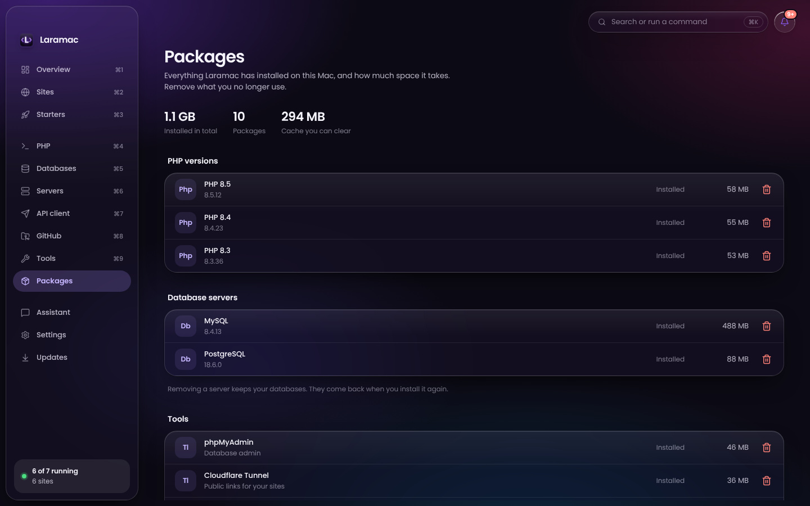

Everything Laramac has installed, with its size: PHP versions, database servers, tools, Homebrew packages and the download cache. Remove what you no longer use. Removing a database server keeps your databases; they come back when you install it again.

### Settings

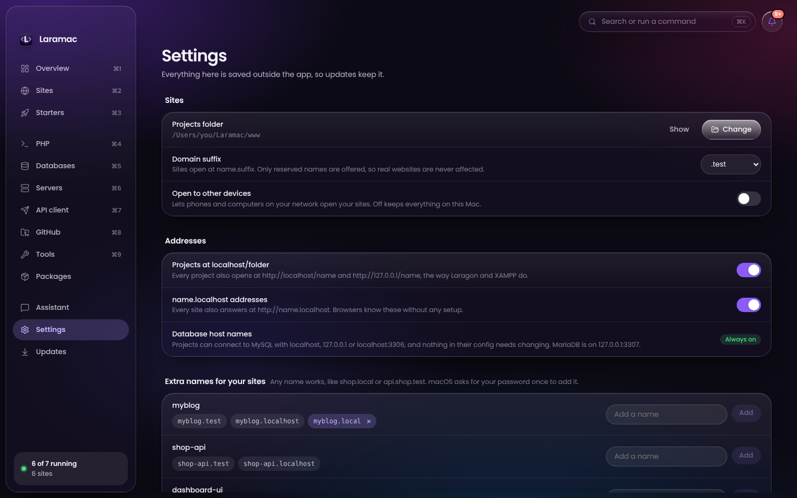

- **Projects folder.** Defaults to `~/Laramac/www`, kept out of Documents so iCloud does not sync it.
- **Domain suffix.** `.test` by default.
- **Open to other devices.** Lets phones and computers on your network open your sites.
- **Addresses.** `localhost/folder`, `name.localhost`, and extra names per site.
- **Web servers.** Make Apache or Nginx the main one and change their ports.
- **Glass style.** Smoked (dark tinted glass everywhere, the default) or Frosted (light glass that follows your Mac's light and dark mode). Pop-ups and menus always use smoked glass.

  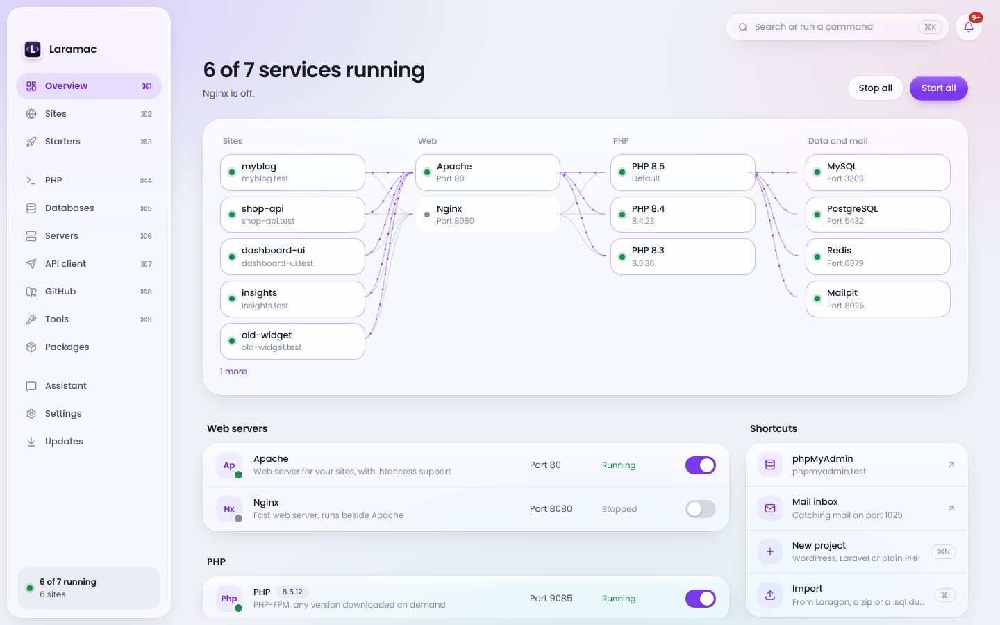
- **Downloads, connections and notifications.**
- **Reset.** Clears software, data, settings or system changes without uninstalling. Your projects are never touched.

### Updates

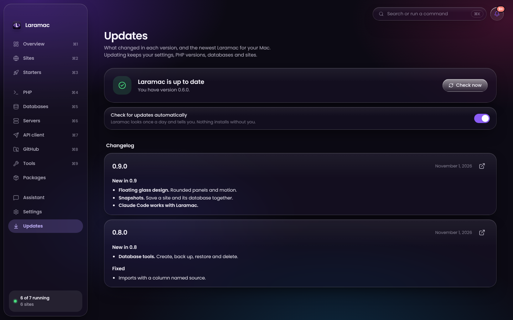

Laramac checks for new versions once a day and shows a banner when one is ready. **Updates** has the changelog for every version. Updating downloads the new app, verifies its checksum and signature, swaps it in place and restarts. Your settings, PHP versions, databases and sites stay exactly as they were.

### Everywhere

- **⌘K** opens a command bar for every site, service and action.
- **⌘1 to ⌘9** switch pages, **⌘N** starts a new project and **⌘I** imports one.
- The **menu bar** icon starts and stops everything and opens phpMyAdmin, the mail inbox and your projects folder.
- **Notifications** tell you when installs finish, links are shared or a service stops unexpectedly; the bell keeps the history.
- Light and dark appearance follow macOS, with Liquid Glass on macOS 26 and later.

---

## Coming from Laragon

Most projects run without any changes:

| In Laragon | In Laramac |
| --- | --- |
| `C:\laragon\www\project` | `~/Laramac/www/project` |
| `http://project.test` | `https://project.test` (HTTP works too) |
| `http://localhost/project` | `http://localhost/project` |
| MySQL `localhost`, user `root`, no password | The same, unchanged |
| Mailpit on `127.0.0.1:1025` | The same |
| HeidiSQL | phpMyAdmin or Adminer, or connect any client to `127.0.0.1:3306` |
| Menu › PHP › Version | Per site, on the Sites page |

To move a site: zip the project folder together with its `.sql` export (from HeidiSQL or phpMyAdmin) and open it with **Import** (⌘I). Laramac loads the database and points the config at it.

---

## Where things live

| What | Where |
| --- | --- |
| Your projects | `~/Laramac/www` (an existing `~/www` is used if you have one) |
| PHP, databases, tools, downloads | `~/.laramac` |
| Node.js, Python (uv), .NET, Go, Rust, Bun | `~/.laramac/runtimes` |
| Dev server output | `~/.laramac/logs/dev-<site>.log` |
| Database data | `~/.laramac/data` |
| Settings | `~/.laramac/settings.json` |
| Your own PHP settings | `~/.laramac/conf/php-<version>.custom.ini` |
| Logs | `~/.laramac/logs` |
| Snapshots | `~/.laramac/snapshots` |

Updating Laramac replaces only the app, so all of this stays.

**Ports used:** Apache 80 and 443, Nginx 8080 and 8443, PHP-FPM 9080 to 9085 (one per version), databases as listed above, Mailpit 1025 and 8025, dev servers from 5170, the `.test` DNS resolver on 53535, and the Claude Code connection on 53536 (only when turned on). All but the web servers listen on `127.0.0.1` only.

---

## Troubleshooting

**`.test` addresses do not open.** On the Overview, press **Turn on** under ".test addresses". This writes one file, `/etc/resolver/test`, and asks for your password once.

**The browser warns about the certificate.** Press **Trust** under "Trust local HTTPS" on the Overview. Firefox keeps its own certificate list: import `~/.laramac/certs/laramac-ca.pem` there.

**`SQLSTATE[HY000] [2002] No such file or directory`.** Make sure MySQL is running. Laramac points PHP at its MySQL socket, so `localhost` works; if you changed `php.ini` yourself, remove any `pdo_mysql.default_socket` line.

**A service will not start.** Its row shows the reason. The most common one is another app using the same port (an old MAMP or Homebrew MySQL, for example): stop that app, or change Laramac's ports in Settings.

**Apache or Nginx says Homebrew is needed.** Install Homebrew from [brew.sh](https://brew.sh), then press Install again.

**"Laramac is damaged and cannot be opened."** That only affected builds before 0.5.1. Reinstall with the one-line installer above.

**Start over.** Settings › Reset clears whatever you choose. To uninstall completely, quit Laramac, delete it from Applications and delete `~/.laramac`.

---

## Security

Laramac runs servers on your Mac, so it is built to stay closed by default:

- **Only your Mac can reach your sites** unless you turn on "Open to other devices". Databases, PHP, Mailpit and the DNS resolver listen on `127.0.0.1` only.
- **The local certificate authority can only vouch for your local suffix** (`.test`), so even a leaked key could not impersonate a real website.
- **The interface is sandboxed** with a strict Content Security Policy; every request it makes is validated in the main process before anything runs.
- **Admin rights are used only** to write `/etc/resolver/test`, trust the certificate, and add names you chose to `/etc/hosts`, each time with your password.
- **Every download is verified** against published SHA-256 checksums, and app updates are signature-checked before they install.
- **Secrets stay in the Keychain:** SSH and FTP passwords and your GitHub token are encrypted with macOS safeStorage. The GitHub token is handed to git per command and never written into a repository.
- **SSH host keys are pinned** on first connect; a changed key is refused.
- **Imports are checked** for unsafe archives, and SQL dumps cannot run commands on your Mac.
- **The Claude Code connection** listens only on `127.0.0.1`, needs a private key, refuses web pages, and its database access is read-only.
- **Deploys never delete** anything on the server and keep `.env` and other secrets local.

Please report security issues privately through GitHub security advisories.

---

## Development

```sh
npm install
npm run dev        # run with hot reload
npm run typecheck
npm test           # unit tests, plus end-to-end tests against real Apache, Nginx, PHP, MySQL, MariaDB, OpenSSH and FTP when present
npm run dist       # build a DMG (macOS)
```

| Folder | What is in it |
| --- | --- |
| `src/main` | The Electron main process. `configgen.ts` writes Apache, Nginx, PHP and MySQL config; `svc/` has one file per service; `importer.ts`, `snapshots.ts`, `deploy.ts`, `github.ts`, `apiclient.ts` and `mcp.ts` hold the features of the same names. |
| `src/renderer` | The React interface. One file per page in `src/pages`. |
| `src/shared` | Types shared by both, including the typed IPC channel map. |
| `tests` | Unit and end-to-end tests. |
| `.github/workflows` | Builds and signs the DMGs, and builds every new PHP release for macOS. |

## Contributing

Issues and pull requests are welcome.

## License

MIT. Laramac is not affiliated with Laragon, Laravel or GitHub.
